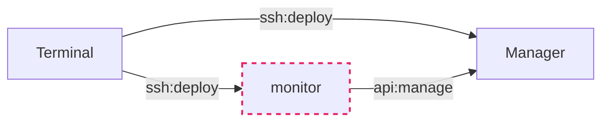

# 概览
MC服务端管理器
提供常见的java8、17、21环境，支持多实例启动、定时开关机qq机器人控制、便捷备份恢复

简易架构图

api指云厂商提供的服务器实例控制api接口
虚线表示可选开启

manager和monitor可以独立部署，terminal仅作为控制编排
基本都需要python和docker环境
## terminal
个人PC、中控、部署manager与monitor
支持Windows与Linux
### 功能
- 存放配置与密钥
- 部署、管理Manager与monitor
- 整合包与存档临时备份点


## manager
实际管理运行整合包的服务器，大内存、一般按量计费、定时开关
### 功能
- 整合包生命周期管理
创建、启动、状态查询、日志查询、执行控制台指令、停止、备份、恢复、移除
- 定时关机与服内广播
用户级cronjob定时触发指令
- 容器化
按需构建java镜像作为整合包运行环境，挂载整合包目录启动容器
通过docker方便实现开机自启

## monitor
可选的7x24h值守，方便定时自动开关机与qq机器人交互管理
需包年包月的服务器，配置1C2G即可
### 功能
- QQ机器人
通过QQ消息控制Manager：开关机、资源利用率
管理整合包：启停、状态、查询在线人数、简要日志、发广播
- 7x24h值守
可在指定时间自动让Manager开关机
周期性检查，该开了但关着，该关了却还开着时告警、关机
## 当前本地使用

```bash
python3 -m pip install -r requirements.txt
./mcsp.sh config check config.yml.example
cp config.yml.example config.yml
cp .env.example .env

# 检查并部署 Manager
./mcsp.sh deploy manager --check
./mcsp.sh deploy manager

# 在本地准备整合包，填充 src/ 后上传
./mcsp.sh pack create example
./mcsp.sh pack deploy example
./mcsp.sh pack start example

# Manager 云主机电源
./mcsp.sh manager status
./mcsp.sh manager start
./mcsp.sh manager stop
```

`manager stop` 会先通过 SSH 执行远端 `manager.sh stop-all`，成功后才调用电源 API；
只有显式使用 `--force` 才允许停服失败后继续关机。详细 Manager 命令见
[manager/readme.md](./manager/readme.md#manager-命令)。
## 1.账号
需持有Linux服务器与sudo账号
[账号创建](./manager/readme.md#账号创建)
可以使用密码，但更建议配置[ssh免密登录](./manager/readme.md#ssh免密登录)
## 2.整合包
zip、tar.gz都行，支持从url下载
[整合包标准目录结构](./manager/readme.md#整合包标准目录结构)

整合包 ID 仅允许大小写英文字母、数字和减号（`A-Z`、`a-z`、`0-9`、`-`）。
# 详情
## 目录结构
/lib/{cli.py,config.py,deploy.py,modpacks.py,power.py,remote.py,tencent.py}

/mc.{sh,exe}
/{config.yml,.env,README.md}
配置、密钥、说明

/manager/{readme.md,manager.sh,lib/,runtime/,modpacks/}
lib/{archive.py,cli.py,config.py,docker.py,modpacks.py,power.py,schedule.py}
runtime/{java{8,17,21}.dockerfile,entrypoint.sh}
modpacks/template/{src/,data/,backups/,config.yml}

/monitor/{src/,data,compose.yml,entrypoint.sh}
src/{app.py,power.py,config.py,network.py,menu.py,messages.json}
后续可能改go实现

/dev存放开发时需要的工具
release.py 构建发行版
spec.md 当前文档

# 定时开关机
## monitor

## 电源 API

Manager 和 Monitor 各自通过 `power-api` 配置目标实例。内置 `tencent` 与通用
`webhook` 两种 provider：

```yaml
power-api:
  provider: webhook
  instance-id: minecraft-manager
  instance-region: local
  url: https://example.com/mcsp/power
```

Webhook 使用 `POST`，固定从 `.env` 读取 `POWER_API_TOKEN` 并作为 Bearer Token。
请求 JSON 包含 `action`（`status`、`start` 或 `stop`）、`instance-id` 和
`instance-region`。`status` 必须返回规范化状态：

```json
{"state": "RUNNING", "public-ip": "203.0.113.1"}
```

`public-ip` 可省略；`start`、`stop` 可返回空对象。状态使用
`RUNNING`、`STARTING`、`STOPPING`、`STOPPED`。

## 腾讯云编程子用户
https://console.cloud.tencent.com/cam
新建用户-快速创建
访问方式： 控制台登录× 编程访问√
用户权限-新建自定义策略-按策略语法创建-空白模板-下一步
复制粘贴
```json
{
  "statement": [
    {
      "action": [
        "cvm:DescribeInstances",
        "cvm:StartInstances",
        "cvm:StopInstances"
      ],
      "effect": "allow",
      "resource": [
        "*"
      ]
    }
  ],
  "version": "2.0"
}
```
创建完成，回到https://console.cloud.tencent.com/cam
点击用户名-API密钥-新建密钥
成功获取POWER_SECRET_ID POWER_SECRET_KEY
# TODO
- 重构中。 参考 dev/refactor-plan
- 实现cos
