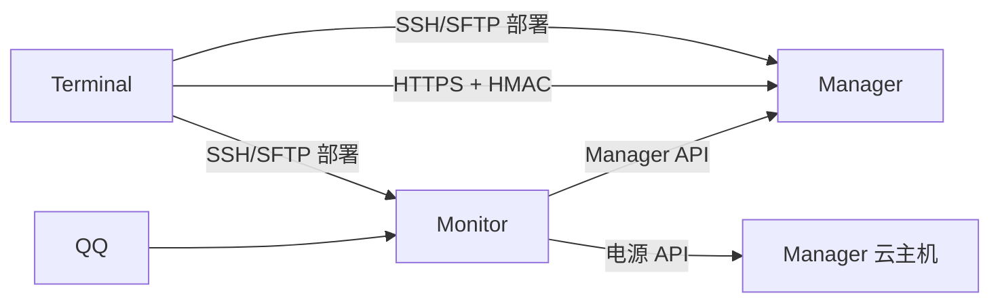

# MC-ServerPack

面向个人 Minecraft 服务器的部署与管理工具。Terminal 在你的电脑上负责编排，Manager
运行游戏服务端，Monitor 可选地提供定时开关机、告警和 QQ Bot。



## 组件

- **Terminal**：保存总配置，准备远端账号和 Docker，部署组件并调用 Manager API。
- **Manager**：必需。以常驻容器管理整合包、备份、迁移和定时任务。
- **Monitor**：可选。7×24 小时监控 Manager 云主机，通过 QQ 发送告警和公开通知。

Manager 和 Monitor 均可独立部署，远端宿主机只需 Docker Engine 与 Compose
插件，不需要项目 Python 环境。

## 准备 Terminal

Linux 发行版使用 `./mcsp`，Windows 在 CMD/PowerShell 中使用 `mcsp.exe`。
源码用户需要 Python 3.9+：

```bash
python3 -m pip install -r lib/requirements.txt
./mcsp.sh --help
```

初始化配置：

```bash
./mcsp.sh config init
# 编辑 config.yml 和 .env
./mcsp.sh config check
```

`manager.timezone` 和 `monitor.timezone` 使用 IANA 时区，例如
`Asia/Shanghai`。`manager.host` 是 Manager 主机的域名或 IP。

## 首次部署

如果远端只有 root，先创建普通部署用户：

```bash
./mcsp.sh deploy manager --create-user
./mcsp.sh deploy monitor --create-user
```

然后准备 Docker 并部署：

```bash
./mcsp.sh deploy manager --install-docker
./mcsp.sh deploy manager

# 可选
./mcsp.sh deploy monitor --install-docker
./mcsp.sh deploy monitor
```

`deploy manager` 首次运行会在 Manager 内自动生成 `MANAGER_API_KEY` 和私有
TLS CA。Terminal 会取回密钥和 CA；部署 Monitor 时会复用它们。

检查环境：

```bash
./mcsp.sh deploy --test-all
./mcsp.sh deploy manager --test
./mcsp.sh deploy monitor --test
```

## 创建第一个整合包

```bash
cp -a manager/modpacks/template manager/modpacks/mc-vanilla
```

将服务端 JAR 和所需文件放入
`manager/modpacks/mc-vanilla/src/`，再编辑
`manager/modpacks/mc-vanilla/config.yml`。默认会自动选择唯一的顶层 JAR，
原版服务端也使用这个流程。

```bash
./mcsp.sh deploy modpack mc-vanilla
./mcsp.sh manager start mc-vanilla
./mcsp.sh manager enable mc-vanilla
```

`eula: true` 表示你已接受 Minecraft EULA；未接受时 Manager 会拒绝启动。

## 日常命令

### 部署与配置

```bash
./mcsp.sh deploy manager --source
./mcsp.sh deploy manager --config
./mcsp.sh deploy monitor --source
./mcsp.sh deploy monitor --config
./mcsp.sh deploy modpack <id>
```

### Manager 云主机电源

```bash
./mcsp.sh status manager
./mcsp.sh start manager
./mcsp.sh stop manager
```

`stop manager` 会先要求 Manager 停止所有整合包，成功后才关闭云主机。

### 整合包

```bash
./mcsp.sh manager list
./mcsp.sh manager status <id>
./mcsp.sh manager start <id>
./mcsp.sh manager stop <id>
./mcsp.sh manager enable <id> [--now]
./mcsp.sh manager disable <id> [--now]
./mcsp.sh manager logs <id> --lines 100
./mcsp.sh manager console <id> say hello
./mcsp.sh manager property <id> online-mode false
./mcsp.sh manager backup <id>
./mcsp.sh manager backup list <id>
./mcsp.sh manager restore <id> [<backup>] --auto-restart
./mcsp.sh manager export <id> ./<id>.tgz
./mcsp.sh manager import ./<id>.tgz
```

完整的 Manager 部署、配置和命令说明见
[manager/readme.md](./manager/readme.md)。

### Monitor

```bash
./mcsp.sh status monitor
./mcsp.sh start monitor
./mcsp.sh stop monitor
./mcsp.sh monitor add-admin
./mcsp.sh monitor test-alert
./mcsp.sh monitor reset-messages
./mcsp.sh monitor reset-targets
```

QQ 管理员验证、订阅和消息模板见
[monitor/readme.md](./monitor/readme.md)。

## 部署账号

`manager.user` 和 `monitor.user` 必须是非 root 用户。`--create-user` 会交互询问
现有管理账号和新用户名，安装 SSH 公钥、锁定密码、授予免密 sudo，
并在 Docker 组存在时加入该组。

`--key` 接受用于 SSH 登录的私钥路径：

```bash
./mcsp.sh deploy manager --create-user --key ~/.ssh/id_ed25519
```

## 密钥

`.env` 中的云 API 凭据：

```dotenv
POWER_SECRET_ID=
POWER_SECRET_KEY=
```

只有 Token 时填入 `POWER_SECRET_KEY`，`POWER_SECRET_ID` 留空。Manager 和 Monitor
控制同一台云主机时应使用同一组 AK/SK。

`MANAGER_API_KEY` 是 Manager API 的 HMAC 密钥，不是云厂商凭据。它通常由
Manager 首次安装自动生成，无需手工填写。

## 文档

- [Manager 手册](./manager/readme.md)：独立部署、配置与全部运维命令。
- [Monitor 手册](./monitor/readme.md)：调度、QQ Bot、告警与消息模板。
- [Manager 架构](./dev/manager.md)：内部设计、API、任务、日志和目录边界。
- [Monitor 架构](./dev/monitor.md)：状态机、QQ 分层、命令、订阅和通知设计。
- [开发准则](./dev/agents.md)：通用开发约束、测试环境与 TODO。
