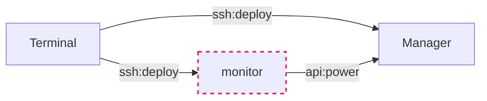

# 概览
MC服务端管理器
提供常见的java8、17、21环境，支持多实例启动、定时开关机qq机器人控制、便捷备份恢复

简易架构图

api指云厂商提供的服务器实例控制api接口
虚线表示可选开启

Manager 和 Monitor 可以独立部署，Terminal 只负责控制编排。
Terminal 与 Manager 需要 Python 3.9+；Manager 和 Monitor 部署目标需要可用的 Docker与Compose
## 组件
### terminal
个人PC、中控、部署manager与monitor
支持Windows与Linux

- 存放配置与密钥
- 部署、管理Manager与monitor
- 整合包与存档临时备份点

### manager
实际管理运行整合包的服务器，大内存、一般按量计费、定时开关

- 整合包生命周期管理
创建、启动、状态查询、日志查询、执行控制台指令、停止、备份、恢复、移除
- 定时关机与服内广播
用户级cronjob定时触发指令
- 容器化
按需构建java镜像作为整合包运行环境，挂载整合包目录启动容器
通过docker方便实现开机自启

### monitor
可选的7x24h值守，方便定时自动开关机与qq机器人交互管理
需包年包月的服务器，配置1C2G即可

- QQ机器人
通过QQ消息查询云主机电源状态、开机和关机
- 7x24h值守
可在指定时间自动让Manager开关机
内部定时器周期性检查并提交幂等开关机，不依赖 cron

## 快速上手
Linux ./mcsp xxx
Windows ./mcsp.exe xxx
Python源码用户
```bash
python3 -m pip install -r lib/requirements.txt
./mcsp.sh xxx
```
最小部署仅需manager，要求docker compose环境

```bash
# 1.配置
./mcsp.sh config init
# 填写config.yml 后执行
./mcsp.sh config check

# 2.部署 Manager
./mcsp.sh deploy manager               # 完整源码部署（包含 Docker 与 Python）

# 3.上传启动 整合包
./mcsp.sh local manager create example # 创建
./mcsp.sh deploy modpack example # 上传到manager
./mcsp.sh manager start example # 远程启动

# 没有现成整合包时，直接在 Manager 创建最新原版服务端
./mcsp.sh manager create vanilla --vanilla --accept-eula
./mcsp.sh manager start vanilla
```

`--install-python` 仅存在于源码入口。源码版完整部署会为远端 Manager 创建
`.venv` 并安装 `manager/lib/requirements.txt`；发行版携带可执行运行时，不安装
Python、pip 或 venv。Monitor 的 Python 依赖始终安装在容器镜像内。

部署期间 apt、pip 和镜像构建等长输出以实时尾窗显示：默认约 10 行，并随终端
高度增加到最多 24 行；步骤成功后折叠为一行。完整输出追加保存在项目目录的
`deploy.log`，失败时终端保留尾部错误并提示该日志路径。

`stop manager` 会先停服，然后关机。详见
[manager/readme.md](./manager/readme.md#manager-命令)。
# 参考
## Terminal命令
```bash
./mcsp.sh deploy manager --create-user # 可选：创建部署用户
./mcsp.sh deploy manager --install-docker # 只安装或验证 Docker
./mcsp.sh deploy manager --install-python # 源码版：安装 Python、venv 与依赖
./mcsp.sh deploy manager --source      # 只同步 Manager 程序文件
./mcsp.sh deploy manager --config      # 同步配置、密钥并应用
./mcsp.sh deploy monitor --source      # 只同步 Monitor 程序文件
./mcsp.sh deploy monitor --config      # 同步配置、密钥并应用

# Manager 电源控制
./mcsp.sh status manager
./mcsp.sh start manager
./mcsp.sh stop manager

# Monitor 容器电源控制（宿主机保持 7x24h 运行）
./mcsp.sh status monitor
./mcsp.sh start monitor
./mcsp.sh stop monitor

# 部署 Monitor 后验证 QQ 私聊，并更新名为 owner 的目标
./mcsp.sh monitor add-target
# 也可以指定其他目标名称
./mcsp.sh monitor add-target backup-owner
```
## Monitor配置
需要腾讯云API密钥控制manager定时开关机（支持其他厂商API，但需自行参考dev/agents.md#电源API 实现）
填入 .env POWER_SECRET

## 整合包
zip、tar.gz都行，支持从url下载
[整合包标准目录结构](./manager/readme.md#整合包标准目录结构)

整合包 ID 仅允许大小写英文字母、数字和减号（`A-Z`、`a-z`、`0-9`、`-`）。

`manager create <id> --vanilla` 通过远端 `manager.sh` 从 Mojang 官方版本清单获取
最新正式版；也可用 `--vanilla <version>` 锁定版本。服务端 jar 会校验官方声明的
文件大小和 SHA-1。默认生成 `eula=false`；只有明确传入 `--accept-eula` 才表示接受
[Minecraft EULA](https://www.minecraft.net/eula) 并生成 `eula=true`。

## 账号
需持有 Linux 服务器与非 root 的免密 sudo 账号；配置中的 `manager.user` 和
`monitor.user` 均不允许填写 `root`。若新服务器目前只有 root，可执行：

```bash
./mcsp.sh deploy manager --create-user
./mcsp.sh deploy monitor --create-user
# 默认依次寻找 ~/.ssh/id_ed25519.pub、id_ecdsa.pub、id_rsa.pub
./mcsp.sh deploy manager --create-user --key ~/.ssh/id_ed25519.pub
```

`./mcsp.sh deploy` 部署 Manager 和已启用的 Monitor；`deploy --test-all` 只检查这些
运行时。单目标检查使用 `deploy manager --test` 或 `deploy monitor --test`。

命令只从对应的 `manager` 或 `monitor` 配置读取 host，不读取其中的 user；它先
询问现有管理员 SSH 用户名（直接回车默认为 `root`），回显并使用私钥测试登录；
登录成功后才询问要创建的部署用户名，并列出公钥写入等即将执行的步骤。
这里只允许 `root` 作为引导账号；配置中的实际部署用户仍禁止为 `root`。非 root
管理员需要已经具备免密 sudo。创建后需将配置中的 user 改为刚创建的用户名。
命令会安装公钥并授予新用户免密 sudo；若服务器已有 `docker` 组，也会将新用户
加入该组。创建后命令即退出，不会同时部署运行时。
[Docker 安装](./manager/readme.md#docker-安装)由 Terminal 直接通过 SSH 执行，不依赖
远端已存在 Manager 或 Monitor 源码；可分别使用 `deploy manager --install-docker`
和 `deploy monitor --install-docker`。完整部署也会幂等安装或验证 Docker。
[账号创建](./manager/readme.md#账号创建)

## 腾讯云API密钥获取
https://console.cloud.tencent.com/cam
新建用户-快速创建
访问方式： 控制台登录× 编程访问√
用户权限-新建自定义策略-按策略语法创建-空白模板-下一步
复制粘贴
```json
{
  "statement": [
    {
      "action": [
        "cvm:DescribeInstances",
        "cvm:StartInstances",
        "cvm:StopInstances"
      ],
      "effect": "allow",
      "resource": [
        "*"
      ]
    }
  ],
  "version": "2.0"
}
```
创建完成，回到https://console.cloud.tencent.com/cam
点击用户名-API密钥-新建密钥
成功获取POWER_SECRET_ID POWER_SECRET_KEY
## 腾讯云按量计费实例固定IP
为了省钱，关机选项默认为：关机不计费
> 参考`lib/providers/tencent.py`
所以需要将cvm的IP调整为 弹性公网IP
否则每次开关机IP都会变动
