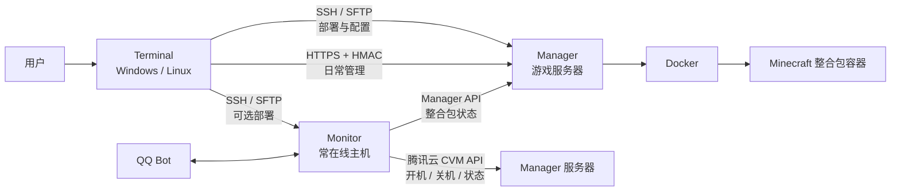

# MC-ServerPack

MC-ServerPack 是面向个人 Minecraft Java 服务器的部署与管理工具，由三个可独立部署的
组件组成。通常只需在自己的电脑上运行 Terminal，由它通过 SSH 部署远端组件并完成日常
管理。

普通用户请从 [GitHub Releases](https://github.com/TunArund/MC-ServerPack/releases)
下载对应平台的完整包；它包含稳定 `lib/` 运行库和可替换的 `data/` 程序层。
使用方法见 [Terminal 手册](./terminal/readme.md)。

## 架构概览



- **Terminal**：运行在用户电脑上，保存总配置和本地整合包，准备远端账号与 Docker，
  部署 Manager/Monitor，并透明调用 Manager API。
- **Manager**：运行在 Minecraft 服务器上，通过 Docker 管理多个整合包、控制台、备份、
  导入导出和定时关服，暴露Manager HTTP API进行交互
- **Monitor**：可选，适合放在 7×24 小时在线的主机上；负责定时开关 Manager 服务器、
  状态监控、告警和 QQ Bot。
- **lib**：共享 SDK 与 Provider 的源码真源。发行时复制到各组件，各组件运行时不会跨目录
  导入 `lib/`，因此三者仍可独立部署。

Manager 和 Monitor 的目标宿主机只需 Linux、SSH、Docker Engine 与 Compose 插件。
Terminal 能协助安装 Docker，远端不需要安装本项目的 Python 环境。

## 目录索引

```text
MC-ServerPack/
├── terminal/       # 本地控制端、总配置、日志和本地 modpacks 工作区
├── manager/        # Minecraft 运行时、Manager API 和远端 modpacks
├── monitor/        # 服务器监控、调度、告警和 QQ Bot
├── lib/            # 共享 SDK、Docker 安装脚本和云 Provider 真源
├── dev/            # 架构设计、测试及发行工具
└── readme.md        # 项目架构与文档入口
```

- [Terminal 手册](./terminal/readme.md)：下载、快速上手、本地整合包和输出方式。
- [Manager 手册](./manager/readme.md)：独立部署、配置与全部运维命令。
- [Monitor 手册](./monitor/readme.md)：调度、QQ Bot、告警、订阅和消息模板。

## 组件交互

### 部署链路

Terminal 根据 `config.yml` 通过 SSH/SFTP 连接目标主机，检查环境、增量同步组件文件，
再调用组件自己的安装入口。Manager 首次安装会生成 Manager API 密钥和私有 TLS CA，
Terminal 取回后供自身与 Monitor 使用。

### 管理与整合包链路

`mcsp manager ...` 通过 HTTPS 调用 Manager API，并使用 `MANAGER_API_KEY` 做 HMAC
认证。长操作进入 Manager Job 队列，Terminal 消费任务事件并显示进度。

本地 `mcsp modpack ...` 只管理 `terminal/modpacks/`；远端 `mcsp manager ...` 管理
`manager/modpacks/`。标准部署链路为：

```text
terminal/modpacks/<id>/
  -> mcsp modpack export <id>
terminal/modpacks/<id>.tgz
  -> mcsp deploy modpack <id>
manager/modpacks/<id>/
```

### 电源与监控链路

Terminal 可以直接调用云 Provider 开关 Manager 主机。启用 Monitor 后，Monitor 也可按
日程调用同一 Provider，并通过 Manager API 确认服务状态。腾讯云 Provider 使用
`DescribeInstances`、`StartInstances` 和 `StopInstances`。

## 部署账号

`manager.user` 和 `monitor.user` 必须是普通 Linux 用户，不能使用 root。已有具备免密
`sudo` 的普通用户时，直接写入配置即可；否则执行：

```bash
./mcsp deploy manager --create-user
./mcsp deploy monitor --create-user  # 仅启用 Monitor 时需要
```

命令先询问现有管理员 SSH 用户名并验证登录，再询问要创建的部署用户名。它会创建或复用
该用户、写入本机 SSH 公钥、锁定密码、授予免密 sudo；若服务器已有 `docker` 组，也会
将新用户加入该组。创建完成后命令退出，不会同时部署运行时。

默认自动寻找 SSH 密钥，也可显式指定私钥；程序使用对应的 `.pub` 公钥：

```bash
./mcsp deploy manager --create-user --key ~/.ssh/id_ed25519
```

现有管理账号需要是 root，或已经具备免密 sudo。之后的正常部署使用新建的普通用户。

## 腾讯云 API 密钥获取

1. 打开 <https://console.cloud.tencent.com/cam>。
2. 选择“新建用户”→“快速创建”。
3. 访问方式选择：控制台登录关闭，编程访问开启。
4. 在用户权限中选择“新建自定义策略”→“按策略语法创建”→“空白模板”。
5. 填入以下策略：

```json
{
  "statement": [
    {
      "action": [
        "cvm:DescribeInstances",
        "cvm:StartInstances",
        "cvm:StopInstances"
      ],
      "effect": "allow",
      "resource": [
        "*"
      ]
    }
  ],
  "version": "2.0"
}
```

6. 创建完成后回到 CAM，点击用户名，在“API 密钥”中选择“新建密钥”。
7. 将得到的值填入 Terminal 的 `.env`：

```dotenv
POWER_SECRET_ID=
POWER_SECRET_KEY=
```

不要提交或分享 `.env`。Manager 与 Monitor 控制同一台服务器时使用同一组密钥。
`MANAGER_API_KEY` 是 Manager API 的 HMAC 密钥，不是腾讯云密钥；通常由 Manager 首次
部署自动生成，无需手工填写。

### 按量计费实例与固定 IP

腾讯云 Provider 关机时使用软关机和“关机不收费”模式，具体调用见
[`lib/providers/tencent.py`](./lib/providers/tencent.py)。这种模式下
实例公网 IP 可能在开关机后变化；需要把 CVM 的IP调整为弹性公网 IP
## 开发与发行

源码用户可在仓库根目录执行：

```bash
python3 -m pip install -r terminal/requirements.txt
./terminal/mcsp.sh --help
python3 -m unittest discover -s dev/tests -p 'test_*.py'
python3 dev/release/release.py check
```

共享源码只修改 `lib/` 真源，再由发行工具同步：

```bash
python3 dev/release/release.py --allow-dirty sync
```

开发文档：

- [Manager 架构](./dev/manager.md)
- [Monitor 架构](./dev/monitor.md)
- [开发准则](./dev/agents.md)
- [发行说明](./dev/release/readme.md)
